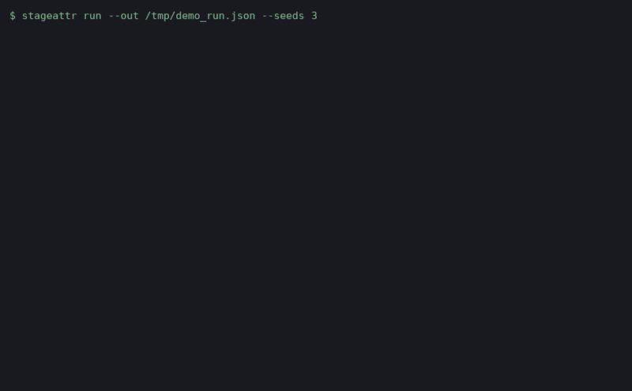

# rag-stage-attribution

**Tells you which stage of a RAG pipeline actually failed: it instruments a
LangGraph pipeline per node and attributes each wrong answer to a retrieval
miss, a rank cut, or a generator that ignored what it was given, against
failures it injected and therefore knows the truth about.**

<!-- badges -->

A wrong answer from a retrieval augmented pipeline cannot say, by itself,
whether the needed chunk was never retrieved or was retrieved and ignored.
Both failures present identically at the output. This repository measures
how well a trace based attribution method recovers the true failing stage,
and names the class of failure that defeats it.

Four questions this answers that an end to end eval does not:

1. When the pipeline is wrong, which stage owns the failure, with an
   interval rather than a guess?
2. How much of that answer comes from node instrumentation, measured by
   taking the trace away?
3. Where does the method break, at what prevalence, and what signal
   repairs it?
4. What does a recall improvement actually buy end to end, decoupled from
   the generator's faults?

## The uncomfortable numbers first

The attribution method recovers the cause in 99.5% of 1172 injected
failures it judged. That number is not the finding. The finding is where
the other cases live and what props the number up:

- **The confusable class performs near a coin flip without help.** When the
  generator ignored a golden chunk sitting in the tail of the context
  window, accuracy is 82.4% with the contract on and drops to 52.9% with
  the contract off, across the 34 tail-ignored failures, with an exact 95%
  interval from 35.1% up to 70.2%. ADR-005 names the class; the mitigation
  is a citation contract the faulty generator itself controls.
- **Without the trace, the method mostly stops working.** Deny the
  attributor the per node trace and overall accuracy falls to 61.9%: it
  places exactly 0 of the 360 retrieval-side failures, and marks 101
  failures as unattributable. That collapse is the opening impossibility,
  measured.
- **Fixing the retriever did not fix the pipeline.** Widening the context
  window lifts recall at context from 83.6% to 90.4%, and those 6.8 points
  of recall bought 3.5 points end to end. After the improvement, 80.8% of
  the failures that remain belong to the generator, which no vector
  database setting will touch.

Credibility line: 216 tests, 98.8% line coverage, every figure above
re-derived by `make verify` from committed experiment outputs, and the
checker that enforces it is demonstrated failing on a deliberately broken
figure in CI. The coverage denominator excludes the two network gated
modules (the embedding capture tool and the live adapter), because offline
CI can never execute them; pyproject declares the exclusion.

## Quickstart

Prerequisites: Python 3.11 or newer. The install below fetches packages
once; after it, nothing here touches the network, and `make verify` runs
offline from the committed fixtures.

```bash
pip install -e ".[dev]"
make verify          # lint + tests + receipts, offline, from a fresh clone
make report          # re-renders docs/experiments/report.md from committed outputs
stageattr run --out /tmp/run.json --seeds 3
stageattr verdict --run /tmp/run.json
```

Re-measuring everything from scratch is `make experiments`; it reruns the
five sweeps and rewrites `docs/experiments/`. The committed outputs are the
capture this README quotes.

## What one run looks like

`stageattr run` pushes all 73 questions through the pipeline under a seeded
injection mix. The retriever returns 12 candidates, the rerank keeps a
window of 4 chunks, the stand-in answers under its injected mode, and each
answer is scored against its golden key phrase, labelled with mechanical
ground truth, and attributed from the trace. `stageattr verdict` then answers the question a team actually asks;
the block below is quoted from the committed demo capture, and a test holds
the quotation to the transcript:

```text
$ stageattr verdict --run /tmp/demo_run.json
verdict: generation
detail:  generation owns 69% of attributable failures and its lower bound clears retrieval's upper bound
  generation: 69.2% (95% CI 60.0% to 77.4%)
  retrieval: 30.8% (95% CI 22.6% to 40.0%)
```

`stageattr attribute --run run.json --qid q012` prints the per failure
reasoning, which is the part a human argues with.

## Attribution accuracy, and what the trace buys (E1)

| arm | accuracy over failures | retrieval-side failures recovered |
| --- | --- | --- |
| default, trace on | 99.5% | 360 of 360 |
| no citation contract | 98.6% | 360 of 360 |
| trace withheld | 61.9% | none of the 360 |

Retrieval blame is read directly off the trace: the attributor recovered
360 of the 360 retrieval-side failures without inference, because the
trace states what the retriever returned and what the rerank kept. Generation blame is inference from lexical support and
citations, and every error the method makes lives there. The ablation arm
is the honest price list: node instrumentation is what converts "the
answer is wrong" into "this stage is wrong".

## Where it breaks (E2)

ADR-004 defines the tail: the last slot of the context window, where
"provided and ignored" and "barely not provided" are nearly the same
observable event. The attributor treats tail presence as weak evidence on
purpose. The cost is the 82.4% and the 52.9% in the first screen, priced
at its real prevalence; the sensitivity arm that widens the tail definition grows the
class to 46 cases and moves the accuracies little, so the blind spot tracks
the definition rather than a lucky threshold.

## Tuning the retriever does not fix a generation problem (E3)

The baseline pipeline answers 46.5% correctly with recall at context of
83.6%. One knob turns: the context window widens from 4 chunks kept
to 6 chunks kept. Recall rises, failures fall, and the failure mix shifts: 69.3% of
failures already belonged to the generator at baseline, and the share
rises to 80.8% after the retriever improves. The decoupling is the point:
recall is a retrieval metric, and spending it on a generation problem buys
little.

## Chunking moves the blame (E4)

Same corpus, same questions, same injected generator; only the chunker
changes. Paragraph chunking puts 10.2% of blame on retrieval misses, and
the fixed window strategy moves it to 8.4% while burying payloads deeper
in bigger chunks. Chunking is not preprocessing; it decides which stage of
the pipeline appears broken. ADR-003 picks the default and prices it.

## The bugs the measurement found

Three were worth keeping, each pinned by a test named after it:

- **The scorer failed its own payload at a sentence boundary.** A golden
  key phrase that closed a sentence tokenised with the period glued on, so
  a faithful answer scored wrong whenever its fact ended the sentence. The
  word boundary matcher and its edge strip exist because of it, in their
  own fix commit, with the story in `tests/test_scoring.py`.
- **The experiment harness cached resources under a partial key.** The
  cache summarised the config by hand and left the tail definition out, so
  E2's sensitivity arms silently reran the baseline definition. The tell
  was two output rows that were byte identical when they could not be. The
  cache now keys on the whole frozen config.
- **The first corpus was too easy to retrieve against.** Questions written
  in the corpus vocabulary gave near total recall and an experiment with
  nothing to measure. The committed golden set is user voice with real
  vocabulary drift, plus distractor documents, which is why retrieval
  failures occur at a realistic rate at all.

## Architecture



```text
question -> rewrite -> retrieve (FAISS flat) -> rerank -> generate
                \          \            \          \
                 +----------+------------+----------+--> per node trace
trace + golden label -> attributor -> verdict (exit 0 / 1 / 2)
seeded injector -> generator mode (never in the trace) -> ground truth
```

## Evidence



The GIF is a replay of captured stdout; every frame comes from
`docs/evidence/demo-manifest.json`, which lists each command with its real
exit code. The architecture SVG is rendered from the committed Mermaid
source by `tools/render_diagram.py`.

## The corpus, including the awkward cases

A committed internal handbook: 22 committed documents, 112 paragraph
chunks, embedded once with MiniLM-L6-v2 into 384 dimensional unit vectors
(manifest dated 2026-10-28, model hash pinned). It is built to be
confusable on purpose:

- Distractor pairs that share vocabulary and disagree on the payload: the
  general expense policy against travel exceptions, on-call rotation
  against incident escalation, vendor security review against vendor
  onboarding.
- 6 pure distractor documents with no golden questions, so dense ranks
  are crowded by plausible neighbours.
- 73 golden questions written in user voice, so the query vocabulary
  drifts from the corpus vocabulary the way real questions do.
- A parametric bank of wrong beliefs shaped like the policy sentences they
  misremember, which is what makes an ignored chunk hard to detect
  lexically.

## What this cannot measure

- **Any real model's behaviour.** The generator is a seeded stand-in;
  injection is what makes ground truth exist. ADR-001 states the boundary
  and what the flag gated Azure OpenAI shaped adapter would add: one real
  model's failure mix, never ground truth.
- **An adversarial generator.** The citation contract repairs most of the
  confusable class, and it is an artifact the faulty component controls. A
  generator that always cites what it ignored collapses the mitigation;
  resolving that needs a signal the generator does not emit. ADR-005 is
  the edge.
- **Semantic support.** Use is inferred lexically. A perfect abstractive
  paraphrase of the golden chunk would read as unsupported; the committed
  stand-in bounds this, a real model would not.
- **Machine dependent figures.** The graph's wall time overhead was
  captured once as a ratio in `docs/experiments/e5_overhead.json` and is
  asserted by a test, not quoted here. The portable costs are counts: 4
  trace records per question and a median of 1688 bytes per question.

## Layout, exit codes, reproduction

```text
src/rag_stage_attribution/
  corpus/        committed docs, golden set, chunkers
  embeddings/    fixture store with drift checks, network gated capture
  retrieval/     rewrite table, FAISS flat store, blend rerank
  generation/    seeded stand-in, paraphraser
  pipeline/      LangGraph graph, trace schema
  attribution/   attributor, ground truth, verdict statistics
  adapters/      the live adapter boundary
experiments/     E1 to E5 capture scripts
fixtures/        corpus, golden, parametric bank, embeddings
tools/           collect_metrics, check_numbers, diagram and demo renderers
docs/            ADRs, experiment outputs, evidence, metrics.json
```

Exit codes are the interface, and two of them are different answers on
purpose: exit codes 0/1/2/3 mean decided, both, refused, and tool error.
Code 1 says both stages contribute materially and the intervals overlap;
code 2 says the evidence cannot carry a verdict at all, for example when
the golden span exists in no chunk, so retrieval cannot be judged. A tool
that folds "both of you own this" into "I cannot tell" teaches its users
to ignore it. Note that `make` returns its own code for any failed recipe,
so automation branches on the `stageattr` script, never on a make target.

`make verify` runs lint, the tests, and the receipts. The receipts
re-measure every published figure from machine readable sources and fail
the build on a mismatch; the checker matches anchored phrases rather than
bare digits, sweeps inside code fences, and runs a reverse pass over this
README and the defense guide that flags any number matching no metric's
rendered value, after stripping the small set of declared context
exemptions (dates, versions, exit codes and their kin). Value matching is the honest limit: a number that happens
to equal a measured value passes on the value alone, which is why the
claims that matter also carry anchors and tests. `tools/prove_checker.py`
breaks a figure on purpose and shows the failure, because a checker nobody
has seen fail is a checker nobody should believe.

## Tech stack

| Technology | Role here | Why here |
| --- | --- | --- |
| LangGraph | the pipeline graph | node boundaries are the instrumentation points attribution consumes; ADR-002 admits the cost |
| LangChain core | runnable and message plumbing under the graph | the pipeline shape a reviewer has seen, without importing the kitchen |
| FAISS flat index | exact dense retrieval | exactness removes an approximation confound, so a miss is a property of the space, not the index |
| MiniLM embeddings | the real retrieval space | captured once to a committed fixture with a pinned manifest, so every run is offline and reproducible |
| SciPy | exact binomial intervals | a blame share over a small sample without an interval is an opinion |
| NumPy | vector plumbing | the fixture is matrices |
| pytest, Ruff, GitHub Actions | verification | the same `make verify` a reviewer runs is what CI runs |

ADRs, in reading order: [ADR-001 injected ground truth](docs/adr/adr-001-injected-ground-truth.md),
[ADR-002 LangGraph over a chain](docs/adr/adr-002-langgraph-over-a-chain.md),
[ADR-003 chunking strategy](docs/adr/adr-003-chunking-strategy.md),
[ADR-004 what counts as retrieved and ignored](docs/adr/adr-004-retrieved-and-ignored.md),
[ADR-005 the confusable class](docs/adr/adr-005-the-confusable-class.md).

## The Pivot

Out of scope, deliberately: a remediation layer that rewrites prompts or
re-chunks based on the attribution. The trigger condition is published
rather than assumed: acting on attribution is safe when accuracy on the
confusable class is high enough that a remediation aimed at the wrong
stage is rarer than the failure it fixes. At 52.9% with the contract off,
it is not. The repository publishes the threshold's inputs and declines to
cross it.

## Future work

- An attention or logit level use signal behind the adapter boundary, the
  only route past ADR-005's adversarial limit; the first metric to watch
  is confusable class accuracy under an adversarial citation policy.
- A second corpus domain to test whether the support floors transfer, with
  the floors re-fit per corpus and the transfer gap published.
- Verdicts over sliced runs (per document, per topic) with the same
  interval discipline.
- Confidence calibration for the attributor's own confidence field against
  observed accuracy.

License: MIT. Versioned by annotated tags; the release history and what
each version added are in [CHANGELOG.md](CHANGELOG.md).
